<h1 align="center">
  <a href="https://github.com/Bensalk/cipher-desk">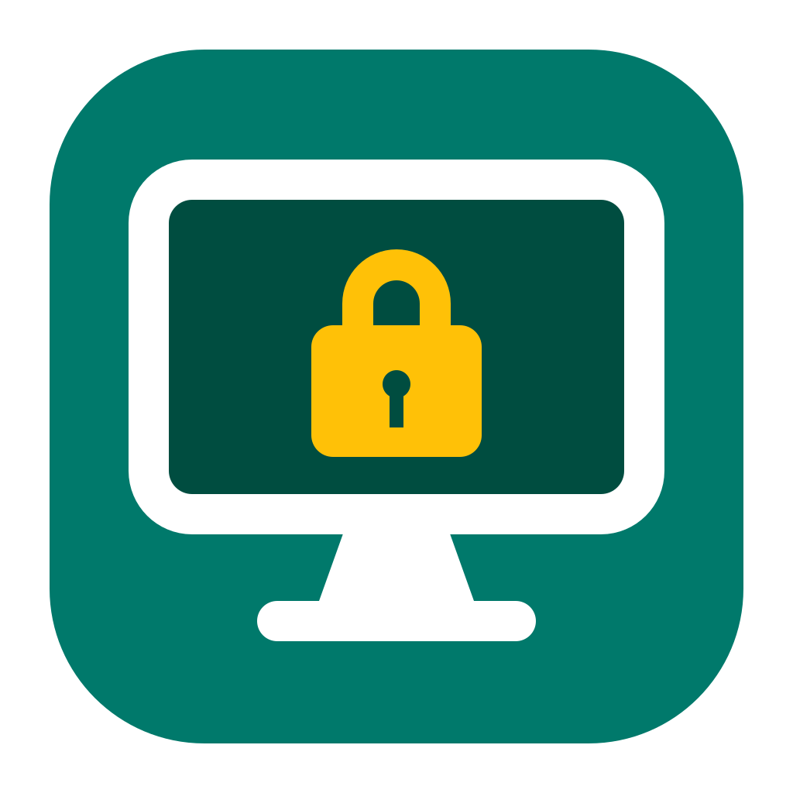</a>
  <br>
  Cipher Desk
  <br>
</h1>

<h4 align="center">A secure, open-source Remote Desktop (RDP) viewer for Windows, Linux and Android.</h4>

<p align="center">
  
  
  
  
  <a href="LICENSE"></a>
  <a href="https://github.com/Bensalk/cipher-desk/actions"></a>
</p>

<p align="center">
  <a href="#key-features">Key Features</a> •
  <a href="#screenshots">Screenshots</a> •
  <a href="#how-to-use">How To Use</a> •
  <a href="#download">Download</a> •
  <a href="#building">Building</a> •
  <a href="CHANGELOG.md">Changelog</a> •
  <a href="#privacy--security">Privacy &amp; Security</a> •
  <a href="#related">Related</a> •
  <a href="#license">License</a>
</p>

<p align="center">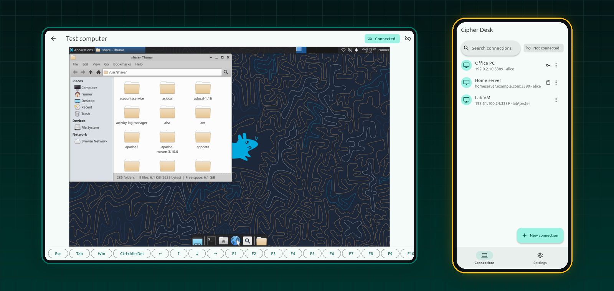</p>

Cipher Desk connects to your own Windows computers over Remote Desktop, from a PC, a Linux machine or an Android phone or tablet. Made by **Bensal** with security first: it only makes protected connections, checks the computer's identity, and never stores a password anywhere except your device's own secure storage. New to Cipher Desk? Follow the [step-by-step guide](docs/HOW-TO-USE.md).

> [!NOTE]
> Cipher Desk is **in development**. No version has been released yet: the first release follows an independent security review. Progress is recorded in [docs/PROGRESS.md](docs/PROGRESS.md).

## Key Features

- **Secure connections only** – Network Level Authentication (NLA) and TLS 1.2 / 1.3. Older, unprotected connections are refused, not downgraded.
- **Certificate check and pinning** – the first time, you compare the computer's fingerprint before anything is sent. If it ever changes, the connection is blocked before your password leaves the device.
- **Saved passwords, safely** – optional, and only in Windows Credential Manager, the Linux keyring or the Android Keystore, confirmed with Windows Hello or your screen lock. Never in the app's files, exports or logs.
- **Clipboard sharing** – two-way text clipboard, off by default; allow it per connection, in one direction or both.
- **Works on touch screens** – tap to click, long-press to right-click, trackpad mode, pinch to zoom up to 4×, and a key bar with Ctrl+Alt+Del, Windows key, Esc, Tab, arrows, F1–F12 and *Type text*.
- **Saved connections** – search, Wake-on-LAN, a *Check readiness* test, connection history, and export / import without passwords.
- **Reliable** – reconnects by itself after a network drop (same computer, same certificate) and never retries a wrong password, so accounts don't get locked.
- **Clear errors** – every message says what happened and what to do next; *Settings → What error messages mean* lists them all.
- **Idle protection** – sessions end after 30 minutes without input (adjustable); on Android, 5 minutes after you leave the app.
- **Portable** – a Windows ZIP and a Linux AppImage that keep everything on a USB drive, except passwords.
- **Light and dark themes**, a side rail on tablets and desktops, and a bottom bar on phones.

## Screenshots

**Phone**

| Connections | New connection | Check the certificate | Remote session |
|:---:|:---:|:---:|:---:|
| 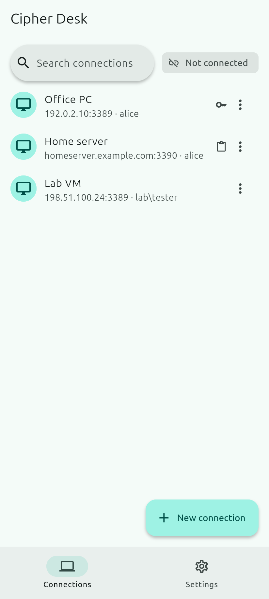 | 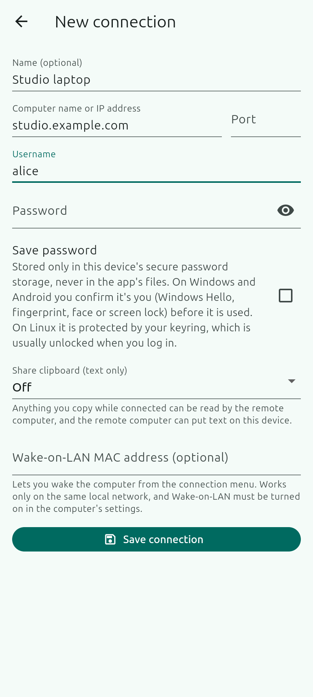 | 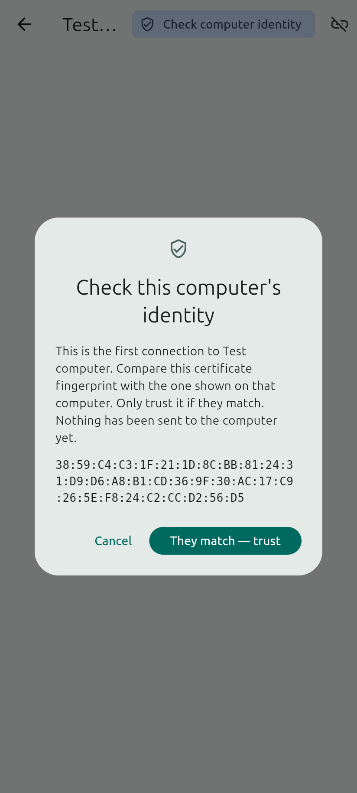 | 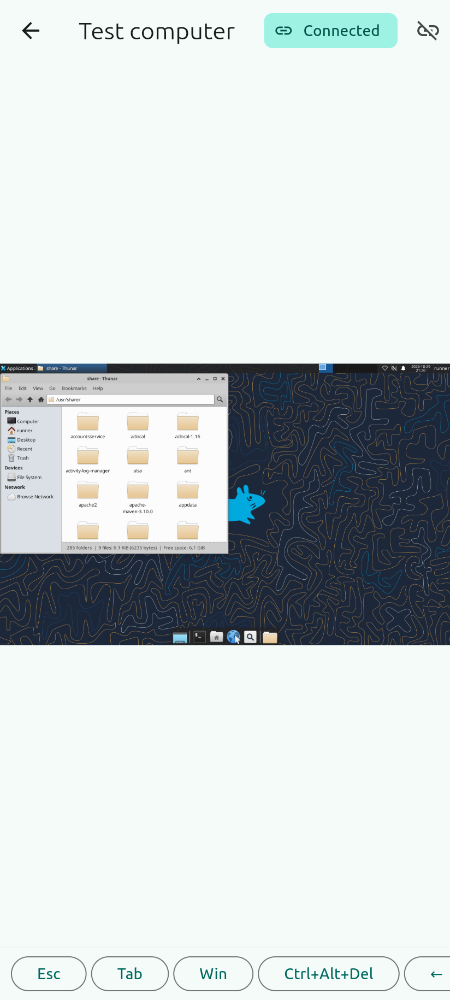 |
| **Settings** | **Clear errors** | **Error help** | **Dark theme** |
| 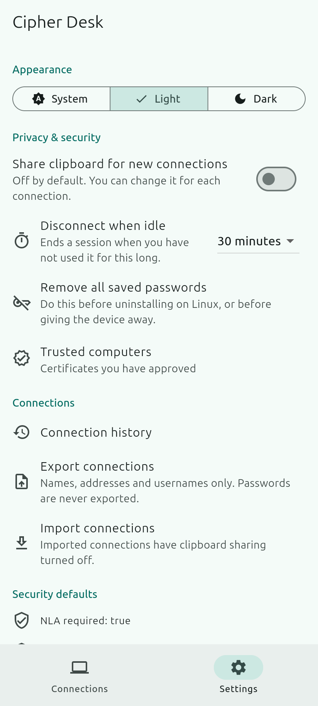 | 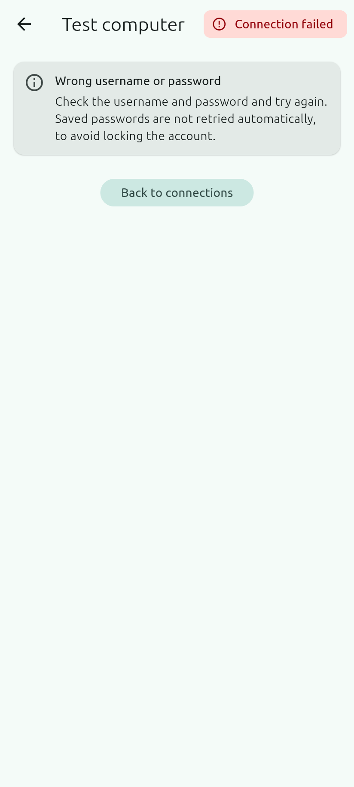 | 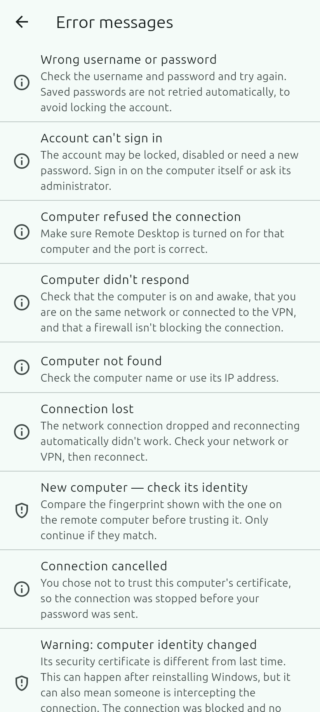 | 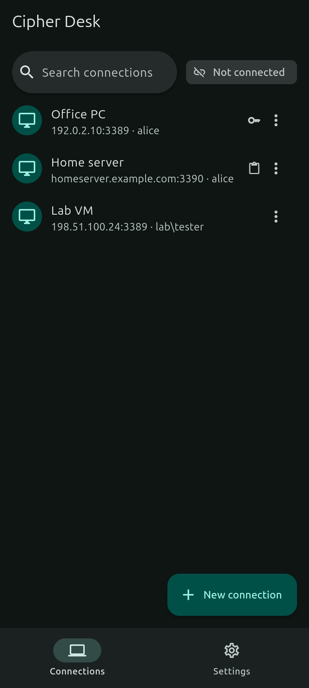 |

**Desktop** (Windows and Linux)

| Connected to a computer | Readiness check |
|:---:|:---:|
| 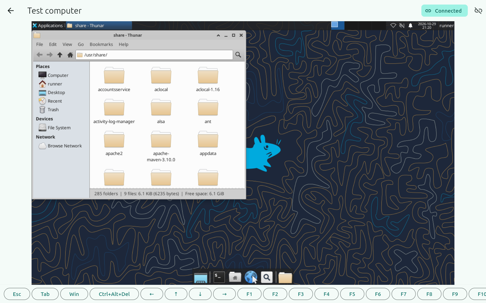 | 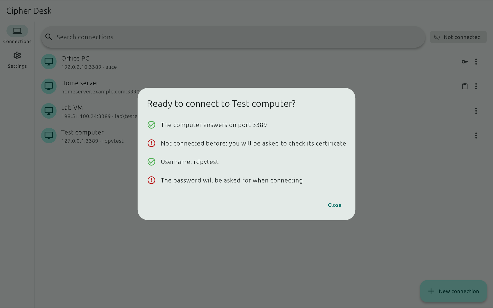 |
| **Connections** | **Trusted computers** |
| 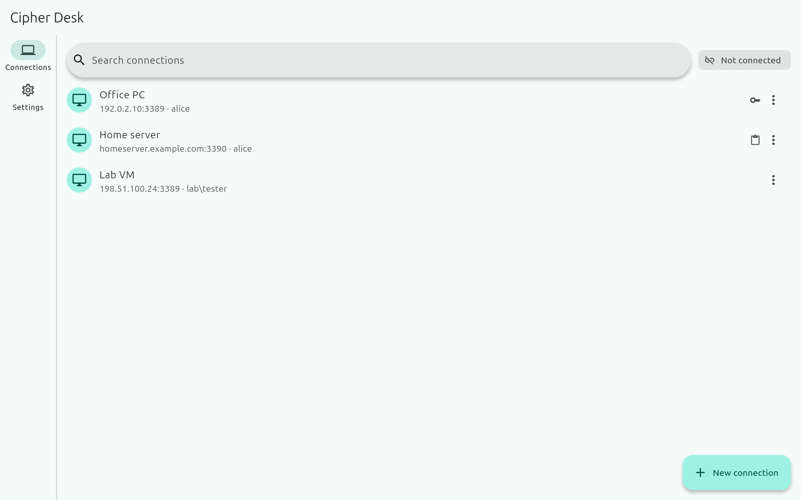 | 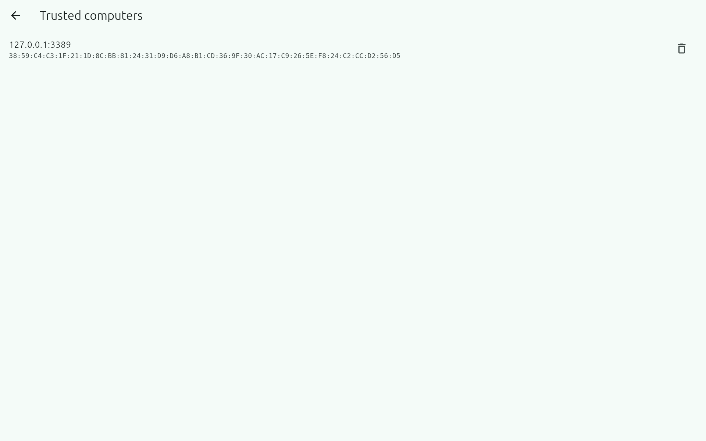 |

**Tablet**

| Connections | Settings |
|:---:|:---:|
| 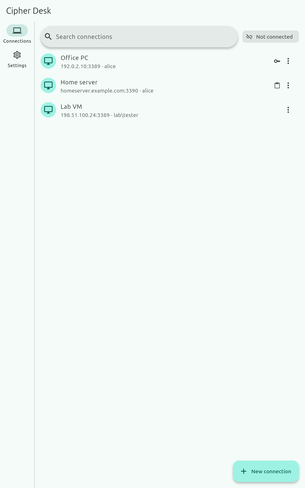 | 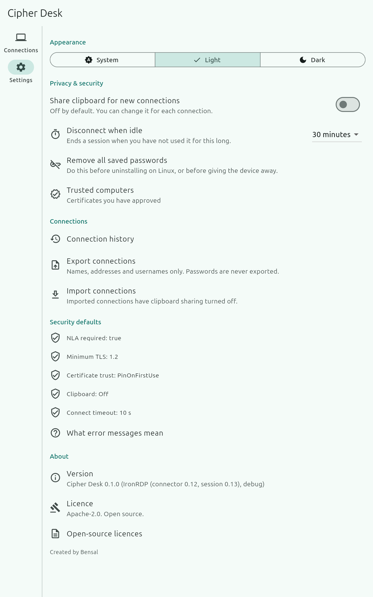 |

> Screenshots are taken automatically from the real app by the [Screenshots workflow](.github/workflows/screenshots.yml), on Linux at phone, tablet and desktop sizes. The remote desktop shown is the project's local test computer. Only sample names and documentation addresses (`example.com`, `192.0.2.x`) are used. Run it again from the Actions tab after UI changes.

## How To Use

> 📖 **Full guide:** [docs/HOW-TO-USE.md](docs/HOW-TO-USE.md) covers installing, adding a computer, checking the certificate, sessions, settings, portable copies, uninstalling and troubleshooting.

**Quick start**

1. Set up the computer you want to reach: turn on Remote Desktop with Network Level Authentication and note its certificate fingerprint. See [docs/HOST_SETUP.md](docs/HOST_SETUP.md).
2. Install Cipher Desk and tap **New connection**. Enter the computer's name or IP address and your username.
3. Tap the connection and type your password (or tick **Save password** to keep it in this device's secure storage).
4. The first time, **compare the certificate fingerprint** with the one on the computer. Only trust it if they match.
5. Use the key bar for Ctrl+Alt+Del, the Windows key and F-keys. Tap the link icon to disconnect.

> [!TIP]
> Only connect over your own network or a VPN. Never expose Remote Desktop (port 3389) directly to the internet.

## Download

- **No release yet.** The first release will be published on the [Releases page](https://github.com/Bensalk/cipher-desk/releases) after the security review. Release notes will be in [CHANGELOG.md](CHANGELOG.md).
- Planned files: Windows 10/11 MSI and portable ZIP, Linux `.deb` and AppImage, Android 10+ APK, each with a SHA-256 checksum and a software bill of materials (SBOM).

## Building

Every push is built and tested on GitHub Actions (Windows, Linux and Android), including live tests against local RDP test computers, fuzzing and security scans.

```bash
# Requirements: Rust 1.97.0 (pinned in rust-toolchain.toml), Flutter stable,
# and for Android the Android SDK + NDK with Java 17
$ sh scripts/install-hooks.sh                # secret-scanning pre-commit hook
$ cargo test --workspace                     # Rust core tests
$ cargo install flutter_rust_bridge_codegen --version 2.13.0 --locked
$ cd app
$ flutter_rust_bridge_codegen generate --no-add-mod-to-lib
$ flutter pub get
$ flutter run -d linux                       # or: -d windows, or an Android device
```

- Shared Rust core: `rust/core` (built on [IronRDP](https://github.com/Devolutions/IronRDP) and rustls); bridge to Flutter: `rust/bridge`.
- Flutter app for every platform: `app/`. Installers and portable packages: `packaging/`.
- Live tests, fuzzing and release builds: see [CONTRIBUTING.md](CONTRIBUTING.md) and [docs/RELEASING.md](docs/RELEASING.md).

<details>
<summary>Repository layout</summary>

| Path | Contents |
|------|----------|
| `rust/core` | Shared Rust core: connection engine (TLS + NLA, certificate pinning, input, reactivation), security and logging policy, secrets handling, form validation, status and error messages |
| `rust/bridge` | flutter_rust_bridge API layer used by the Flutter UI |
| `app/` | Flutter app (Windows, Linux, Android) |
| `app/rust_builder` | Builds the Rust library for each platform (Cargokit, from flutter_rust_bridge) |
| `scripts/` | Git hooks, security policy checks, test hosts, release build helper |
| `rust/fuzz` | Fuzzers for our parsers of untrusted input (test-only, separate workspace) |
| `tools/rdp-test-host` | Test-only RDP host (NLA + scriptable clipboard) for live tests; never shipped |
| `tools/icon` | Draws the app icon (original artwork) for every platform |
| `tools/syntax-check` | Syntax-only Dart/Kotlin checker for machines without Flutter (optional) |
| `packaging/` | Installers and portable packages: Linux `.deb`/AppImage, Windows MSI (WiX)/portable ZIP, icons |
| `docs/` | How-to-use guide, host setup, threat model, security review, releasing, progress record, plan |

</details>

## Privacy & Security

- **No accounts, no tracking.** Cipher Desk has no analytics, telemetry or ads, and there is no Cipher Desk server: it talks to your computers directly.
- **Passwords stay on your device.** Saved passwords live only in the operating system's secure storage. They are never written to the app's files, never exported, and never logged.
- **Identity checked every time.** Each computer's certificate is pinned after you approve it; a changed certificate blocks the connection.
- **Clipboard off by default**, and screenshots of the app blocked on Android by default.
- **Android permissions, and why:**

  | Permission | Why |
  |---|---|
  | Internet | Connects to your computers |
  | Notifications / foreground service | Keeps a session open while you switch apps, and shows that a session is open |

  Windows and Linux need no special permissions; Windows Hello is used only to confirm a saved password.
- **Only install from this repo's [Releases](https://github.com/Bensalk/cipher-desk/releases).** Each release will list the SHA-256 of every file and the Android signing certificate, so you can check your download.
- How it was checked: [threat model](docs/THREAT_MODEL.md) and [security review](docs/SECURITY_REVIEW.md). Setting up the remote computer safely: [docs/HOST_SETUP.md](docs/HOST_SETUP.md).
- Found a security problem? Report it privately, see [SECURITY.md](SECURITY.md).

## Related

- [Crosshair](https://github.com/Bensalk/crosshair) – Bensal's light crosshair overlay for FPS games on Android.
- [GST Calculator](https://github.com/Bensalk/gst-calculator) – Bensal's offline GST calculator for Android and Windows.

## License

Open source under the [Apache-2.0](LICENSE) licence. Third-party components are listed in [NOTICE](NOTICE).
