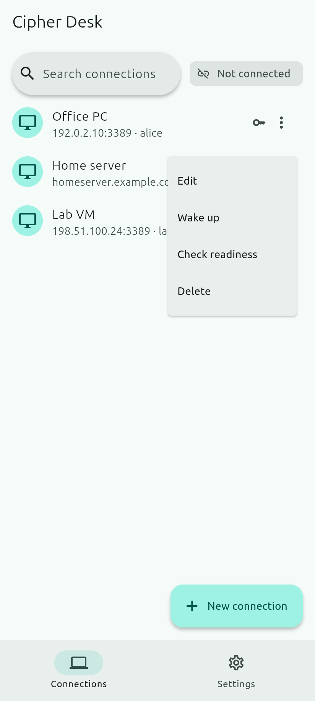
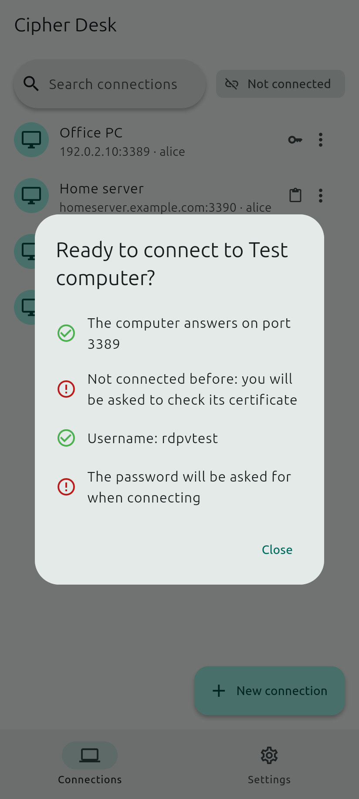
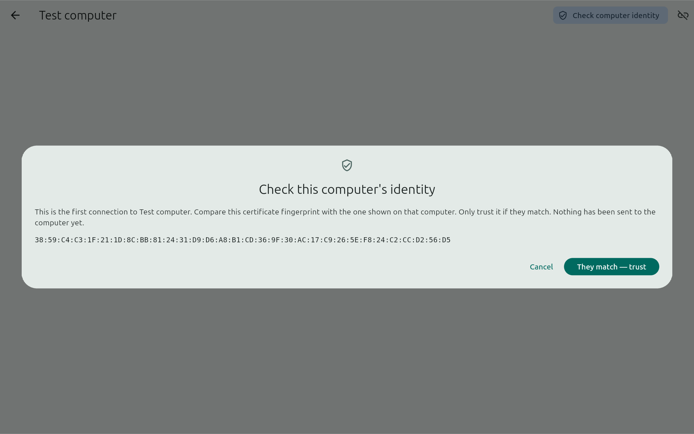
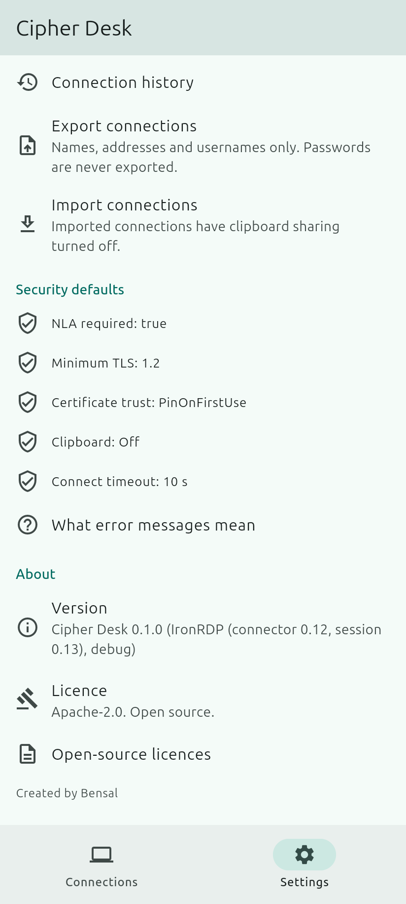
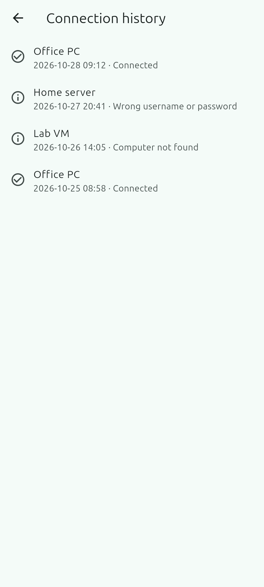

# How to use Cipher Desk

A step-by-step guide, from installing the app to your first secure connection. Back to the [README](../README.md).

- [1. Install](#1-install)
- [2. Add a computer](#2-add-a-computer)
- [3. The first connection: check the certificate](#3-the-first-connection-check-the-certificate)
- [4. During a session](#4-during-a-session)
- [5. Settings](#5-settings)
- [6. Portable copies](#6-portable-copies)
- [7. Uninstall](#7-uninstall)
- [8. Troubleshooting](#8-troubleshooting)

---

Before you start, set up the computer you want to connect to:
[`HOST_SETUP.md`](HOST_SETUP.md). Only connect over your own network or a VPN.

## 1. Install

Download from the project's **Releases** page and check the file against
`SHA256SUMS` (`sha256sum -c SHA256SUMS` on Linux, `Get-FileHash` on Windows).

| System | File | Notes |
|--------|------|-------|
| Windows 10/11 (64-bit) | `CipherDesk-<version>-x64.msi` | Installs for your user only (no administrator rights), adds a Start-menu entry and, if you keep it ticked, a desktop shortcut. Installing a newer version upgrades in place. |
| Windows, no install | `CipherDesk-<version>-windows-x64-portable.zip` | Unzip anywhere (e.g. a USB drive) and run `cipher_desk.exe`. See *Portable copies*. |
| Debian / Ubuntu | `cipher-desk_<version>_amd64.deb` | `sudo apt install ./cipher-desk_<version>_amd64.deb`. Adds an app-menu entry. |
| Other Linux | `Cipher_Desk-<version>-x86_64.AppImage` | Make it executable and run it. |
| Android 10+ | `CipherDesk-<version>-android.apk` | Allow installing from this source when asked. Compare the signing certificate with the one in the release notes. |

If the release notes say the Windows files are **unsigned**, Windows SmartScreen
may warn you; check the SHA-256 checksum first.

## 2. Add a computer

**New connection** → enter a name (optional), the computer's name or IP address,
the port (leave empty for 3389) and the username (`user`, `DOMAIN\user` or
`user@domain`). Optional:

- **Save password** — tick it and type the password to keep it in this device's secure
  storage (Windows Credential Manager, the Linux keyring, the Android Keystore), never
  in the app's files. Windows asks for Windows Hello and Android for your
  fingerprint/face/screen lock before it is used. Without it, you type the password
  each time you connect.
- **Share clipboard** — off by default. Anything you copy while connected can be read
  by the remote computer, and it can put text on this device. You can allow one
  direction only.
- **Wake-on-LAN MAC address** — lets you wake the computer from the connection's menu
  (same local network only).

**Check readiness** in the connection's menu tests whether the computer answers and
whether everything is set up.

| New connection | Connection menu | Check readiness |
|:---:|:---:|:---:|
|  |  |  |

## 3. The first connection: check the certificate

The first time, the app shows the computer's **certificate fingerprint** and has not
sent anything yet. Compare it with the fingerprint shown on that computer
(`HOST_SETUP.md` §2). Only trust it if they match.

If a computer you trusted later shows **"Warning: computer identity changed"**, the
connection is blocked and no password is sent. This can follow a Windows reinstall,
but it can also mean someone is intercepting the connection. Only use **"I know why
it changed — trust the new certificate"** after checking the new fingerprint on the
computer itself.

## 4. During a session

- **Keyboard and mouse** work as usual on a computer. The bar at the bottom has
  Esc, Tab, Windows, **Ctrl+Alt+Del**, arrows, F1–F12 and **Type text**.
- **Touch screens:** tap to click, long-press to right-click, drag to drag. Turn on
  **trackpad mode** (hand icon) to move a pointer like on a laptop trackpad. Pinch to
  zoom up to 4×; the zoom button shows the whole screen again.
- **Clipboard** (if allowed): an icon in the title bar shows the direction. On Android,
  text you copy on the phone is sent when you return to the app or tap *Send clipboard*.
- **Network drops:** the app reconnects by itself (up to 3 tries) to the same computer
  with the same certificate. It never retries a wrong password.
- **Idle:** sessions end after 30 minutes without input (change it in Settings).
- **Android:** a notification shows while a session is open. If you leave the app for
  5 minutes, the session ends; tap **Reconnect** when you come back.

## 5. Settings

Theme · block screenshots (Android, on by default) · share clipboard for new
connections · Windows Hello confirmation (Windows) · idle disconnect · **trusted
computers** (view or forget fingerprints) · **remove all saved passwords** ·
connection history · export / import · what each error message means.

**Export** contains names, addresses, ports and usernames, never passwords. Imported
connections always start with clipboard sharing off.

| Settings | About | Connection history |
|:---:|:---:|:---:|
|  |  |  |

## 6. Portable copies

- **Windows portable ZIP:** the `portable.txt` file next to the app keeps your
  connections, settings and trusted certificates in a `data` folder beside it.
- **Linux AppImage:** create a folder named like the AppImage plus `.data` (for example
  `Cipher_Desk-1.0.0-x86_64.AppImage.data`) next to it to do the same.

Passwords are never written to the drive. "Save password" is off by default; if you
turn it on, the password is stored on the computer you are using, not on the drive,
and the app tells you so. Use **Settings → Remove all saved passwords** before leaving
a computer that isn't yours. Anyone who finds the drive can see your computer names and
usernames, so keep it safe.

## 7. Uninstall

| System | How | Saved passwords |
|--------|-----|-----------------|
| Windows (MSI) | *Settings → Apps → Cipher Desk → Uninstall* | Removed automatically for your user |
| Windows portable | Delete the folder | Use *Remove all saved passwords* first |
| Debian / Ubuntu | `sudo apt remove cipher-desk` | Use *Remove all saved passwords* **before** uninstalling (a package cannot reach your keyring) |
| AppImage | Delete the file (and its `.data` folder) | Use *Remove all saved passwords* first |
| Android | Uninstall the app | Removed automatically by Android |

Connections and settings are kept after uninstalling on Windows and Linux, so a
reinstall finds them. To remove them too, delete the app's folder:
`%APPDATA%\Cipher Desk contributors\Cipher Desk` on Windows, or
`~/.local/share/io.github.bensalk.cipherdesk` on Linux.

## 8. Troubleshooting

Every error message says what to do next; *Settings → What error messages mean*
lists them all. Common ones:

| An error with advice | All error messages |
|:---:|:---:|
|  |  |

- **Computer didn't respond** — it is off or asleep, you are not on the same network or
  VPN, or a firewall blocks port 3389.
- **Secure connection not supported** — turn on Network Level Authentication on the
  computer (`HOST_SETUP.md` §2).
- **Remote Desktop isn't available** — Windows Home cannot accept connections.
- **Wrong username or password** — saved passwords are not retried automatically, to
  avoid locking the account.
